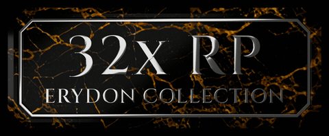
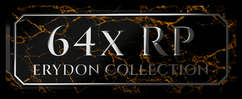

# ERYDON Resource Packs

Version 1.6.0 contains the unified optional resource packs for ERYDON,
ERYDON Themelios, and Daedalon:

| ERYDON 32x Resource Pack | ERYDON 64x Resource Pack |
| --- | --- |
|  |  |
| `packs/32x`: detailed 32x artwork | `packs/64x`: detailed 64x PBR artwork |

Both resolutions are maintained together on `main` in the
[public source repository](https://github.com/erydon-mod/erydon-resource-packs).
Report problems through [GitHub Issues](https://github.com/erydon-mod/erydon-resource-packs/issues).
GitHub hosts source only: no GitHub Releases, release ZIP uploads or release
tags are published here. Release ZIPs are generated from source and are not
tracked in Git.

## Compatibility

Both packs work with any compatible subset of the three mods. The mods contain
their own native 16x resources, so neither optional pack is required.
The single shared 64x overlay colour, normal, and specular set is supplied by
the family mods and is deliberately not overridden by either resource-pack ZIP.

The current packs target Minecraft 1.20.1 through 1.21.1 resource-pack formats.
The `compat2` filename component and pack marker identify family compatibility
generation 2 independently from this pack's semantic release version.
Deduplicated ZIPs require resolver-capable ERYDON family mod builds with the
matching family generation. A LabPBR-compatible shader is needed for the full
material effect.

## Validate and build

The validation workflow uses Python 3.13 and Pillow 12.1.1. Select that Python
interpreter as `python`, activate a virtual environment if used, then run these
commands from the repository root:

```sh
python -m pip install -r requirements.txt
python -B -m unittest discover -s tools -p "test_*.py" -v
python -B tools/extend_daedalon_repeat_surfaces.py
python tools/build_packs.py --output-dir dist
```

The final command creates both deterministic, deduplicated release ZIPs:

- `dist/ERYDON-32x-Resource-Pack-compat2-v1.6.0.zip`
- `dist/ERYDON-64x-Resource-Pack-compat2-v1.6.0.zip`

It also writes `resource-pack-build-report.json` and
`RESOURCE_PACK_SHA256SUMS.txt` in `dist/`. It builds each ZIP twice and requires exact
byte equality, validates the committed deduplication plans, compares every
packaged logical path with physical source bytes, checks CTM layout and
properties, and verifies the sources remain unchanged. It also requires the
deduplicated ZIP to be smaller than its physical control and, where configured,
no larger than the reviewed release-artifact size baseline.

Use `--no-texture-dedupe` with the build command to create non-aliased physical
fallback ZIPs for older mod builds. This writes the same release filenames, so
use a separate output directory when retaining both modes.

The authored `packs/` directories are source material. Build installable ZIPs
with this tool instead of directly zipping those directories. Place a finished
ZIP in Minecraft's `resourcepacks` folder and enable it above general-purpose
packs that override the same resources. Leave the ZIP compressed.

## Updating source artwork

Run `python tools/refresh_texture_dedupe_plans.py` after intentionally changing
physical PNG sources, then review and commit the generated plans. Refresh the
committed release-artifact size baseline only after reviewing intentional
artwork changes that make the previous content set no longer comparable.
Exact rebuilds may match the ceiling; later builds may not exceed it without
another reviewed baseline refresh.

Daedalon OBJ material sheets use two exact horizontal copies of the established
6x6 repeat surface so placed models can select a safe tile origin from world
position. After replacing a square `statue_spartan_promachos_*` source, run
`python tools/extend_daedalon_repeat_surfaces.py --write`, then run it once more
without `--write` before refreshing the deduplication plans.

## Licence

This repository is source-available under Oliver's restricted licence. It is
not open-source material; see [LICENSE](LICENSE). Public source access does not
change the existing licence terms. Each pack retains its `LICENSE.txt`.
Branding provenance and artwork slots are documented in [BRANDING.md](BRANDING.md).
